# Link Downloader

**Copy a video link, tap Paste, and the video is in your phone's `Downloads/` folder.**

Link Downloader is a small Android app with one screen and one job. It saves videos from YouTube,
TikTok, Instagram, X and most other video sites as ordinary MP4 files, using
[yt-dlp](https://github.com/yt-dlp/yt-dlp) running inside the app. Everything happens on the
phone: no server, no account, no ads, no analytics.


## Contents

- [Why](#why)
- [Using it](#using-it)
- [Every state of the screen](#every-state-of-the-screen)
- [What gets saved](#what-gets-saved)
- [When a download fails](#when-a-download-fails)
- [Privacy and permissions](#privacy-and-permissions)
- [How it works](#how-it-works)
- [Install](#install)
- [Build from source](#build-from-source)
- [Project layout](#project-layout)
- [What it deliberately does not do](#what-it-deliberately-does-not-do)
- [Responsible use](#responsible-use)
- [Credits](#credits) and [License](#license)

## Why

Saving a video you are allowed to keep usually means a website full of ads, a pop-up, a
redirect and a file named with a long random number. Link Downloader replaces all of that with one
tap: it reads the link you copied, picks the best version up to 1080p with sound, and saves it
under the video's own title, where your gallery, Files app and video player already look.

## Using it

1. **Copy a link** in any app. The share sheet's *Copy link* is fine; if the copied text has words
   around the link ("Check this out https://…"), the first link is used.
2. **Open Link Downloader and tap Paste link.** The download starts at once. You can also type or
   paste a link into the field and press the keyboard's **Go** key.
3. **Watch it run, or leave.** The orb in the middle shows what is happening: it reads the link,
   then fills a ring with the percentage inside. Leave the app and the download keeps going, with a
   notification that shows the progress and has a **Cancel** button.
4. **Open it.** When the video is saved the orb turns green, the phone gives a light tick, and
   **Open** plays it. The field empties itself, ready for the next link.

| 1. Ready | 2. Downloading | 3. Saved |
|:---:|:---:|:---:|
| 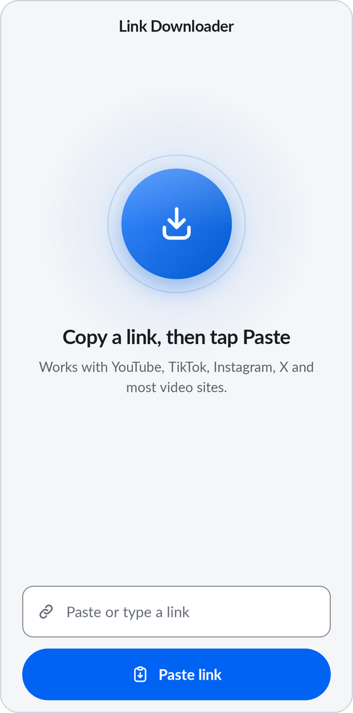 | 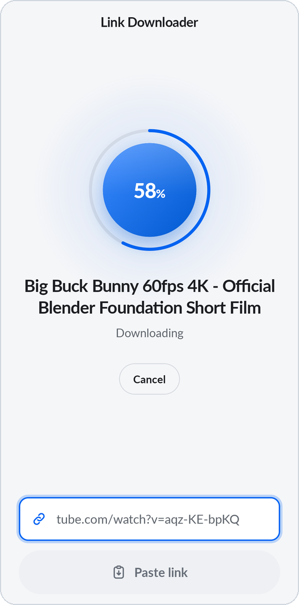 | 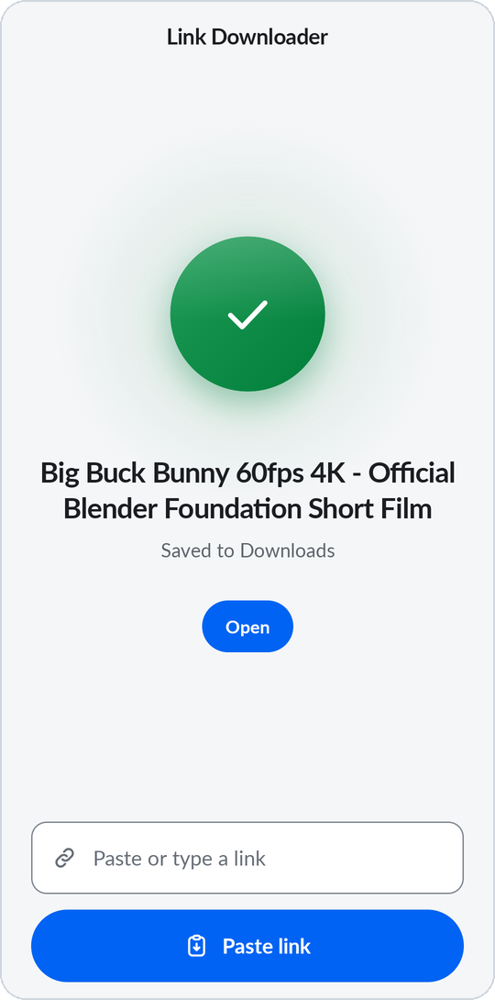 |
| Copy a link anywhere, then tap **Paste link**. | The title appears as soon as it is known; **Cancel** stops the download and deletes its partial files. | The file is in `Downloads/`, named after the video. **Open** plays it. |

## Every state of the screen

There is only one screen, so everything the app can tell you happens in the same place: the orb
changes colour, and the words under it always say the same thing in plain language.

| Reading the link | Downloading | Saved |
|:---:|:---:|:---:|
| 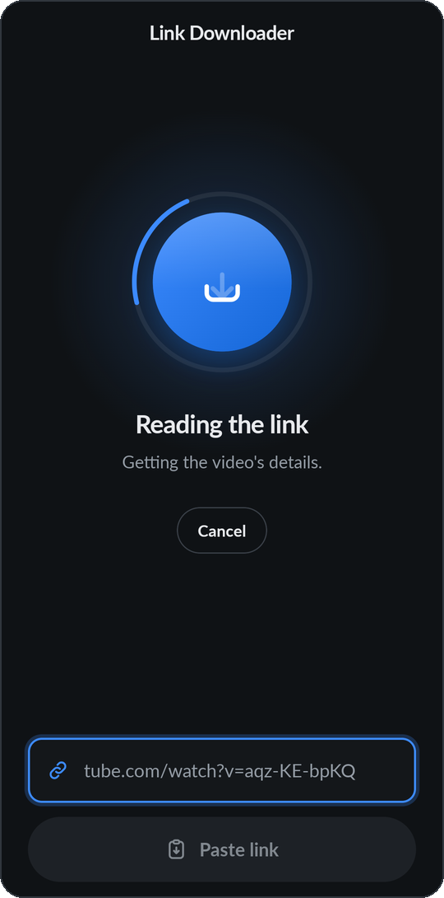 | 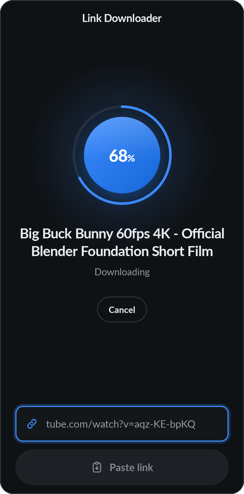 | 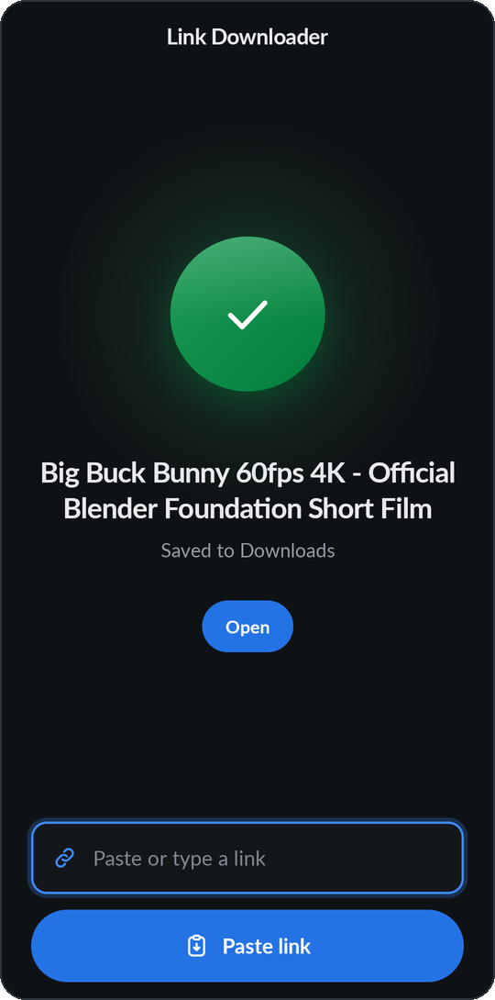 |
| yt-dlp is looking up the video. An arc turns and the arrow drops into the tray. | The ring fills, never backwards. A post with several videos also says "2 of 3". | Green with a check and one ripple. |

| Already saved | Failed | About |
|:---:|:---:|:---:|
| 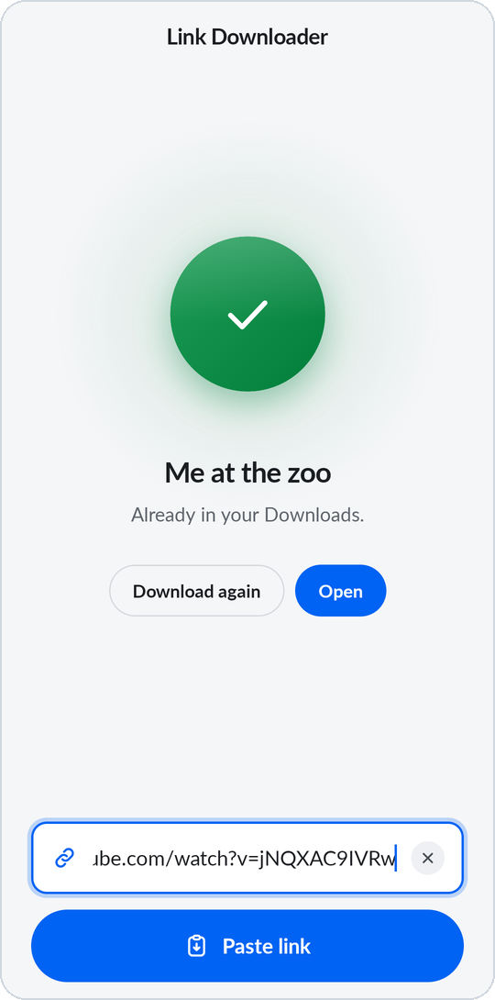 | 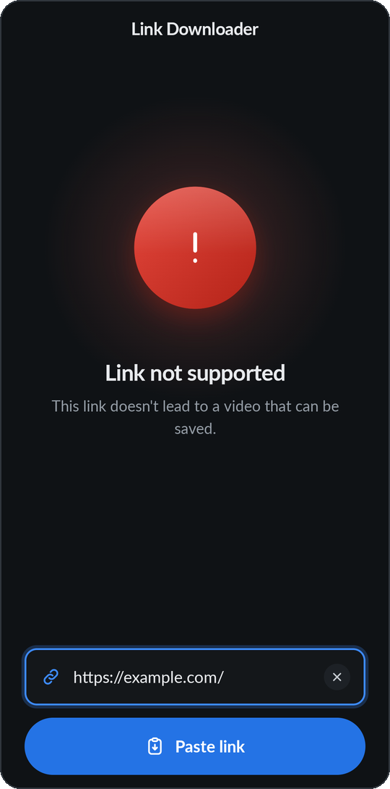 | 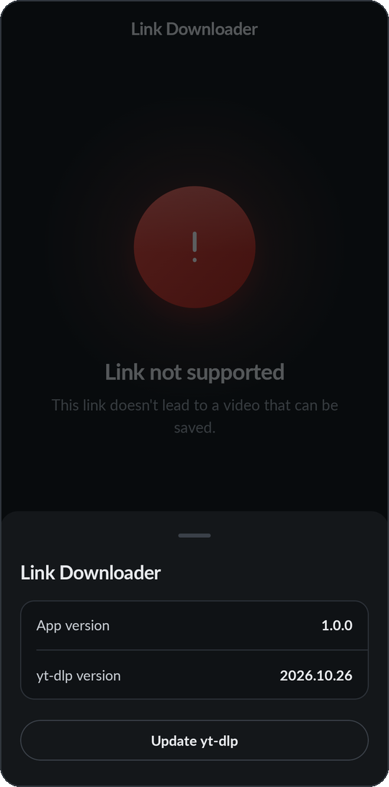 |
| Pasting the link you just saved does not make a duplicate. **Download again** saves a second copy on purpose. | A short title and one plain sentence; never a raw error. **Try again** appears when the problem may pass. | Long-press the title bar to see the app and yt-dlp versions and to update yt-dlp by hand. |

**Posts with several videos.** When a link leads to a post with more than one video (an X post with
two clips, an Instagram carousel), a sheet shows a thumbnail and the length of each one, all
selected. Tap thumbnails to choose one, some or all, then **Download**: each video is saved as its
own file, one after another. If you are not in the app when the choice comes up, a notification
asks you to choose.

**Light and dark.** The app follows the phone's theme. Both are finished designs, and every piece
of text meets WCAG AA contrast, checked by a unit test. With the phone's animations turned off,
every animation stays still.

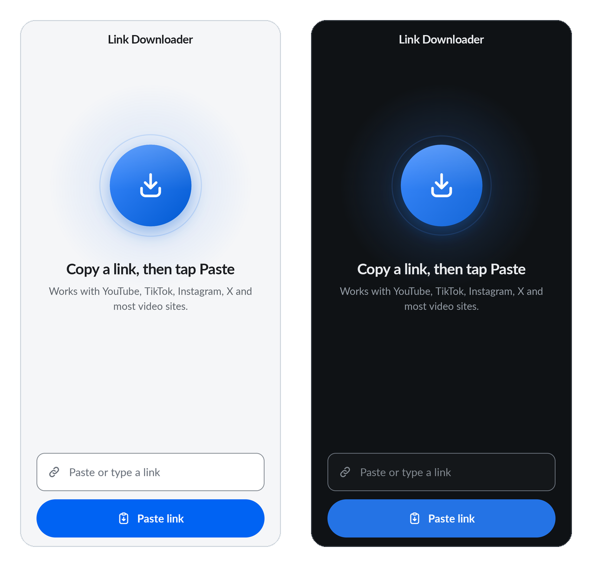

## What gets saved

| | |
|---|---|
| **Sites** | Whatever yt-dlp supports. Tested before every release: YouTube (videos and Shorts), TikTok, Instagram (Reels and posts) and X. |
| **Quality** | The best available up to 1080p (measured on the short side, so vertical videos keep 1080×1920), with sound. |
| **Format** | MP4. Separate video and audio streams are joined on the phone without re-encoding, so quality is not lost. WebM only when a site offers nothing else. |
| **File name** | The video's title, cleaned of characters that file systems reject. A name that is taken gets ` (1)`. |
| **Where** | The shared `Downloads/` folder, visible in the gallery, the Files app and on a PC over USB. |
| **What is never downloaded** | Whole playlists or profiles, private videos, and anything that needs a login. |

yt-dlp is kept up to date automatically, at most once a day, in the background. Sites change often,
and a fresh yt-dlp is what keeps downloads working.

## When a download fails

The screen and the notification give one of five plain reasons. The technical error goes to the
system log only.

| You see | It means | Try again |
|---|---|:---:|
| **You're offline** | No network before or during the download. | Yes |
| **Link not supported** | yt-dlp does not know the site, or the link is not a video. | No |
| **Video unavailable** | The video is private, removed, or age- or region-locked. | No |
| **Sign-in required** | The site only shows the video to signed-in users, or asks for a bot check. | No |
| **Download failed** | Anything else. | Yes |

## Privacy and permissions

- **No server, no account, no tracking.** The app talks only to the site of the link you gave it
  (and the servers that site uses for its videos and thumbnails) and, at most once a day, to
  GitHub to check for a new yt-dlp.
- **The clipboard is read only when you tap Paste link**, never in the background or on launch.
- **No storage permission.** Files are written through Android's MediaStore, which needs none on
  Android 10 and newer.
- **No logins or cookies** are ever asked for or stored.

| Permission | Why |
|---|---|
| `INTERNET`, `ACCESS_NETWORK_STATE` | To download, and to say "You're offline" at once instead of waiting for a timeout. |
| `FOREGROUND_SERVICE`, `FOREGROUND_SERVICE_DATA_SYNC` | So a download keeps running when you leave the app. |
| `POST_NOTIFICATIONS` | Progress, Cancel and the result in the notification shade. Asked once, the first time a download starts; refusing it does not stop downloads. |

## How it works

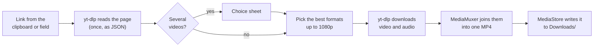

- **yt-dlp on the phone.** [youtubedl-android](https://github.com/yausername/youtubedl-android)
  bundles yt-dlp, a Python runtime and QuickJS for Android. The app extracts a video's details
  once, then hands the same JSON back to yt-dlp for the download, so each site is queried once.
- **No ffmpeg.** The app picks the formats itself (H.264 or HEVC video with AAC audio) and joins
  them with Android's own `MediaExtractor` and `MediaMuxer`. Samples are copied, never
  re-encoded. This keeps the APK smaller and the result identical in quality to the source.
- **Background work.** Each download is a WorkManager job running as a foreground service with a
  notification. Downloads and yt-dlp updates share one queue, so an update never swaps yt-dlp out
  from under a running download, and only one download runs at a time.
- **Safe saving.** The file is created in `Downloads/` as *pending*, so no other app sees it
  half-written, and published only when it is complete. A cancel deletes it along with every
  temporary file.

Kotlin, Jetpack Compose with Material 3, WorkManager and kotlinx.serialization. The full design is
in [docs/architecture.md](docs/architecture.md), and the reasons behind each choice are in
[docs/work/decisions/](docs/work/README.md).

## Install

The app is not on Google Play; it is installed from its APK.

1. Get `app-release.apk` from this repository's
   [Releases](https://github.com/Andyop21/linkdownloader/releases) page when one is published, or
   build it yourself (below).
2. Open it on the phone. Android asks once to allow installing apps from that source (*Install
   unknown apps*).
3. Or, with USB or wireless debugging on: `adb install -r app-release.apk`.

**Requirements:** Android 10 or newer, on a 64-bit ARM phone (`arm64-v8a`, which covers nearly
every current phone). The first start unpacks the bundled Python, so the very first download
takes a few seconds longer to get going.

## Build from source

You need Android Studio (or any JDK 17+) and the Android SDK.

```bash
git clone https://github.com/Andyop21/linkdownloader.git
cd linkdownloader
./gradlew assembleDebug        # debug APK in app/build/outputs/apk/debug/
./gradlew installDebug         # install it on a connected phone or emulator
./gradlew testDebugUnitTest    # JVM unit tests
./gradlew lintDebug            # Android lint (warnings are errors)
```

On Windows, use `.\gradlew.bat` in PowerShell or cmd. Debug builds also include `x86_64`, so they
run on a standard Android Studio emulator.

A release build (`./gradlew assembleRelease`) is signed with your own key: create a keystore outside
the repository and point a `keystore.properties` file at it. Without that file the release build
stops with a clear message instead of producing an unsigned APK. The steps, the version scheme and
every other command are in [docs/development.md](docs/development.md).

## Project layout

| Path | What is there |
|---|---|
| `app/src/main/kotlin/…/ui/` | The screen, its ViewModel, the choice and About sheets, the theme |
| `app/src/main/kotlin/…/download/` | The download pipeline, the workers, notifications and the queue |
| `app/src/main/kotlin/…/link/` | Finding the link in a piece of copied text |
| `app/src/test/` | JVM unit tests, with trimmed format lists from each must-work site |
| `app/src/androidTest/` | An on-device probe for real extractions and downloads |
| `docs/` | Product behaviour, architecture, development, and the decision records |
| `prompts/`, `scripts/` | The session prompts and workflow scripts used to build the app |

Start with [docs/product.md](docs/product.md) for exactly what the app does in every case, and
[docs/index.md](docs/index.md) for the rest. Contributors, human or coding agent, read
[AGENTS.md](AGENTS.md) first: it holds the rules for branches, commits and checks.

## What it deliberately does not do

The app stays one screen with one job. Accounts, logins and cookies, playlists and profiles,
audio-only downloads, a quality picker, a download history, a settings screen, a share-sheet target,
Google Play and iOS are all out of scope. See [docs/product.md](docs/product.md) § *Not in scope*.

## Responsible use

This is a personal tool. Download only videos you have the right to save (your own, or ones whose
owner allows it), respect each platform's terms of service and copyright law where you live, and
do not use it to re-upload other people's work.

## Credits

- [yt-dlp](https://github.com/yt-dlp/yt-dlp) does the extracting and downloading (Unlicense).
- [youtubedl-android](https://github.com/yausername/youtubedl-android) packages yt-dlp, Python and
  QuickJS for Android (GPL-3.0); this app uses the build published on Maven Central as
  `io.github.junkfood02.youtubedl-android:library`.
- [Lato](https://www.latofonts.com/) by Łukasz Dziedzic (SIL Open Font License 1.1; the licence
  ships in the app under `assets/licenses/`).
- The screenshots show [Big Buck Bunny](https://peach.blender.org/) (© Blender Foundation,
  CC BY 3.0) and "Me at the zoo", the first video uploaded to YouTube.

## License

GPL-3.0-or-later, the natural fit for an app that bundles youtubedl-android. See [LICENSE](LICENSE).
