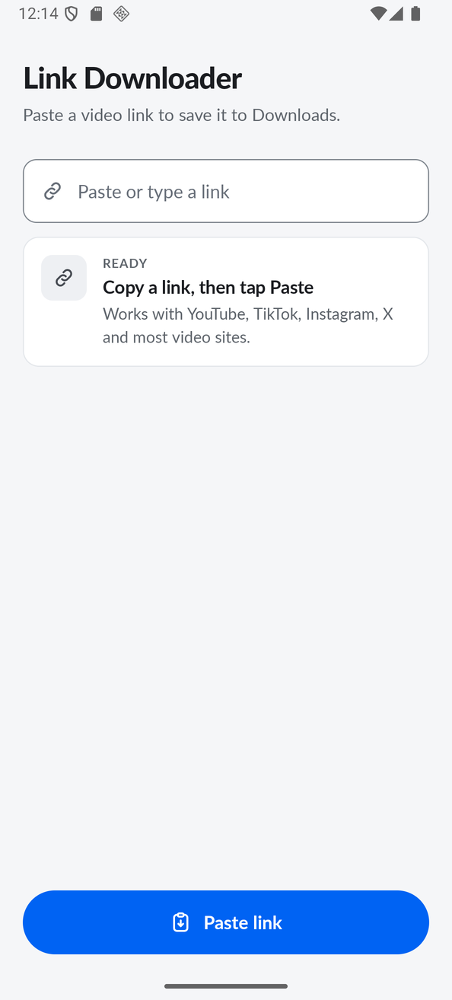

# linkdownloader

A tiny Android app that does one thing: copy a video link, tap **Paste**, and the video lands in
your phone's `Downloads/` folder.

Everything happens on the phone, through [yt-dlp](https://github.com/yt-dlp/yt-dlp) running inside
the app. No server, no account, no ads, no analytics.



## How it works

1. Copy a video link in any app (the share sheet's *Copy link* is fine; text around the link is
   ignored).
2. Open Link Downloader and tap **Paste**.
3. The download starts at once and shows its progress. It keeps going if you leave the app, with a
   notification you can cancel from.
4. The video is saved to `Downloads/` as an MP4 named after its title, ready to **Open**.

A post with several videos (an X post with two clips, an Instagram carousel) offers a choice of
which ones to save. Long-press the header to see the app and yt-dlp versions and to update yt-dlp;
it also updates itself in the background, at most once a day.

See [docs/product.md](docs/product.md) for the full behaviour.

## Supported sites

Whatever yt-dlp supports. These are tested before each release:

- YouTube (videos and Shorts)
- TikTok
- Instagram (Reels and posts)
- X

Videos are saved in the best quality up to 1080p, with sound. Playlists, profiles, private videos
and anything that needs a login are not downloaded.

## Install

The app is not on Google Play; it is installed from its APK.

1. Get `app-release.apk`: from the repository's GitHub releases when one is published, or build it
   yourself (below).
2. Copy it to the phone and open it. Android asks once to allow installing apps from that source
   (*Install unknown apps*).
3. Or, with USB or wireless debugging on: `adb install -r app-release.apk`.

Needs Android 10 or newer on a 64-bit ARM phone (`arm64-v8a`). The first start unpacks the bundled
Python, so the first download takes a few seconds longer to get going.

## Build

Requires Android Studio (or any JDK 17+) and the Android SDK. From the repository root:

```bash
./gradlew assembleDebug      # debug APK in app/build/outputs/apk/debug/
./gradlew installDebug       # install it on a connected phone or emulator
./gradlew assembleRelease    # signed release APK; needs your own keystore.properties
```

Release signing, the version scheme and every other command:
[docs/development.md](docs/development.md).

## Working in this repository

Read [AGENTS.md](AGENTS.md) (identical to [CLAUDE.md](CLAUDE.md)) first. It holds the rules for
humans and coding agents alike. Documentation starts at [docs/index.md](docs/index.md), and
session prompts live in [prompts/](prompts/README.md).

## Responsible use

This is a personal tool. Download only videos you have the right to save (your own, or ones whose
owner allows it), respect each platform's terms of service and copyright law where you live, and
do not use it to re-upload other people's work.

## Credits

- [yt-dlp](https://github.com/yt-dlp/yt-dlp) does the extracting and downloading (Unlicense).
- [youtubedl-android](https://github.com/yausername/youtubedl-android) packages yt-dlp, Python and
  QuickJS for Android (GPL-3.0); this app uses the build published on Maven Central as
  `io.github.junkfood02.youtubedl-android:library`.
- [Lato](https://www.latofonts.com/) by Łukasz Dziedzic (SIL Open Font License 1.1; the licence
  ships in the app under `assets/licenses/`).

## License

GPL-3.0-or-later. See [LICENSE](LICENSE).
